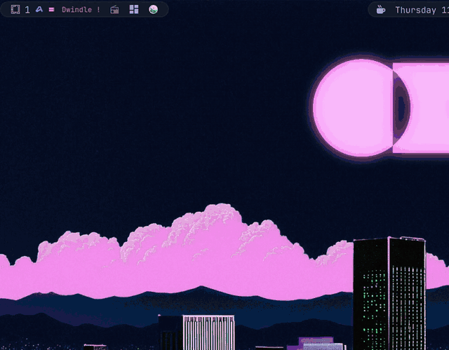

# Fallout Radio

An [Omarchy](https://omarchy.org) bar widget that plays Fallout radio stations while you work, with a green-phosphor terminal tuner for picking them. All ten streams from the fan-run [fallout.fm](https://fallout.fm) are on it.



- **Click** to open the tuner: click a station to play it, or click the one playing to stop it
- **Middle-click** to play or stop without opening it
- **Right-click** for the next station
- **Scroll** to change the volume
- **Hover** to see the station, the song on air and the volume

In the tuner, `↑`/`↓` pick a station, `Enter` or `Space` plays or stops it, `←`/`→` change the volume and `Esc` closes it. The icon is dimmed while the radio is off, and a short burst of static plays as you change stations.

If a stream drops, or the network goes away while the computer sleeps, the tuner shows NO SIGNAL and keeps trying to reconnect on its own. The radio also works with your media keys and Omarchy's media controls through mpv's MPRIS script, which Omarchy installs with mpv.

## Your own stations

Build a station from your own music and it sits in the tuner below the fallout.fm streams. Pick **+ NEW STATION** (or press `N`), give it a name, and tick the songs you want from your music folder (`~/Music` unless you change the `musicFolder` setting; subfolders are included). Saved stations play their songs shuffled, on a loop, and show each song's title from its tags.

- In the song list, `Space` or a click ticks a song, `A` ticks or clears every song in view, `/` jumps to the filter, `N` to the name, `S` saves and `Esc` cancels
- To change a station, highlight it and press `E`, right-click it, or click **E EDIT**
- To delete one, open it and press `X` twice, or click **DELETE** twice

MP3, Ogg, Opus, FLAC, M4A, AAC and WAV files all work. Your stations are saved with the rest of the radio's state.

## Settings

Open the widget's settings from the bar, or add them to its entry in `~/.config/omarchy/shell.json`:

| Setting | Default | What it does |
|---|---|---|
| `phosphor` | `green` | Screen color: `green`, `amber` (New Vegas's own), `blue` or `white` |
| `tuningStatic` | `true` | Static between stations |
| `autoplay` | `false` | Start playing when the desktop starts |
| `startStation` | `Last played` | Station to start on |
| `rememberVolume` | `true` | Keep the last volume; when off, start at `startVolume` |
| `startVolume` | `60` | Starting volume when the last one isn't remembered |
| `musicFolder` | `~/Music` | Where your own stations pick songs from |

The station and volume you last used, and your own stations, are remembered in `~/.local/state/omarchy/nv-radio.json`. The song title comes from mpv as it changes, so the widget does no polling.

## Install

```bash
omarchy plugin add https://github.com/spconley98/omarchy-nv-radio.git --enable
```

## Remove

```bash
omarchy plugin remove io.github.spconley98.nv-radio
```

## Requirements

- [mpv](https://mpv.io), which Omarchy installs by default
- An internet connection to reach `fallout.fm:8444`

## Stations

| Station | Game |
|---|---|
| Radio New Vegas | Fallout: New Vegas |
| Galaxy News Radio | Fallout 3 |
| Diamond City Radio | Fallout 4 |
| Classical Radio | Fallout 4 |
| More Where That Came From (expanded Diamond City Radio) | Fallout 4 |
| Appalachia Radio | Fallout 76 |
| Classical Radio | Fallout 76 |
| Fallout 2 Soundtrack | Fallout 2 |
| Fallout Soundtrack | Fallout |
| Fallout.FM Mix | All games |

Stations that are mostly talk, such as Enclave Radio, Freedom Radio and Black Mountain Radio, have no public stream, so they aren't included.

## Disclaimer

This is an unofficial fan project. It is not affiliated with or endorsed by Bethesda Softworks, ZeniMax Media or Microsoft. Fallout and Fallout: New Vegas are their trademarks. The plugin contains no game audio: it plays the public streams run by fallout.fm, and what those streams play is up to fallout.fm. Your own stations play only files already on your computer.

## License

MIT
